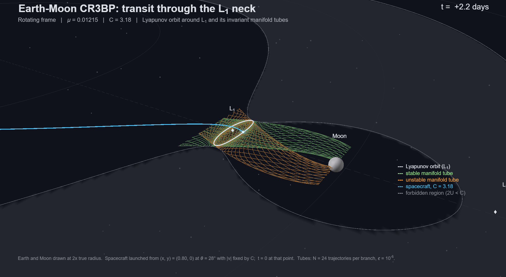
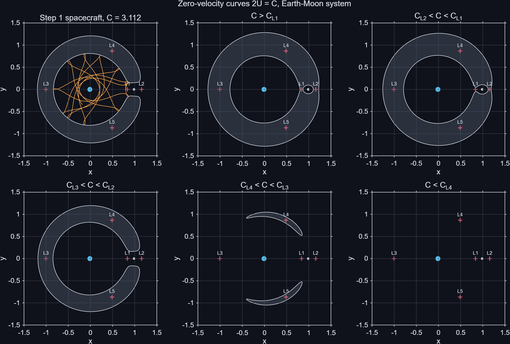
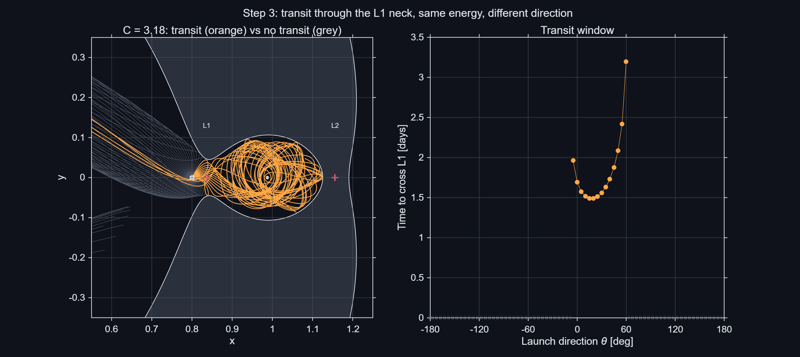
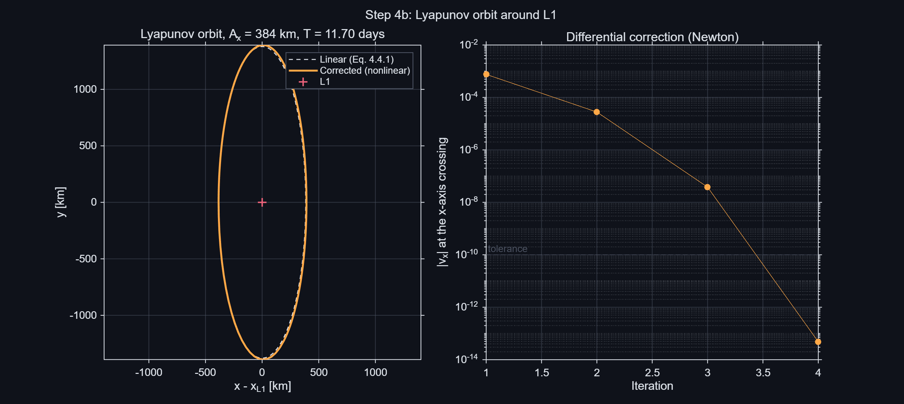
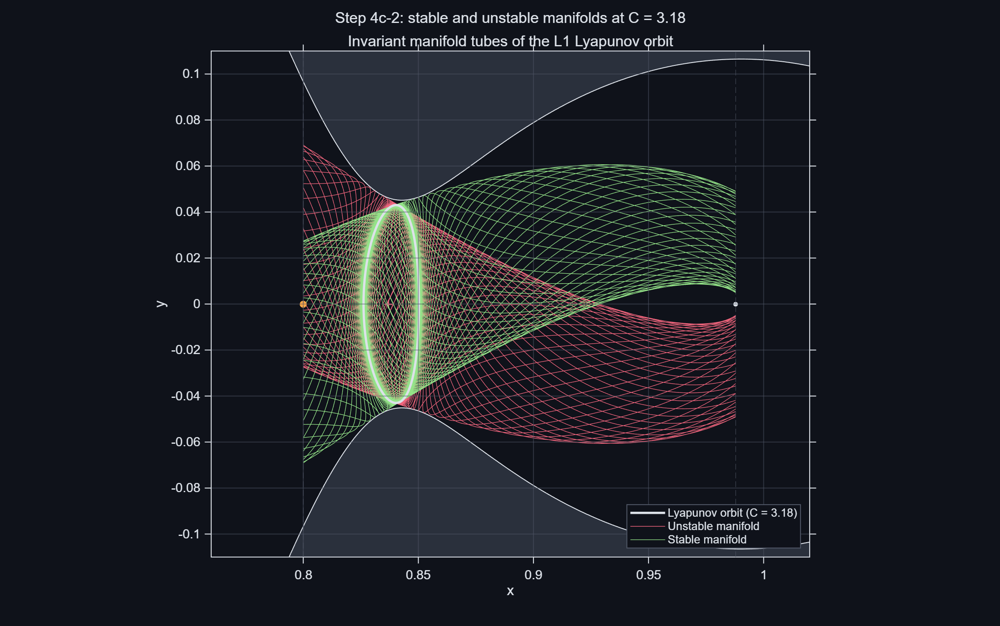

# Transit through the L1 neck of the Earth–Moon system

A step-by-step MATLAB implementation of the **planar circular restricted three-body problem (CR3BP)** for the Earth–Moon system. It starts from the equations of motion and ends with the invariant manifold tubes of a Lyapunov orbit around L1. Those tubes explain why a spacecraft that has enough energy to reach the Moon often fails to get there.

[](figures/cr3bp_transit3d.mp4)

*A spacecraft launched from the Earth side rides the stable manifold tube of the L1 Lyapunov orbit through the neck and is captured in the Moon region. Rotating frame, C = 3.18. Click the image for the video.*

**Paper:** [Transit Through the L1 Neck of the Earth–Moon System: Lyapunov Orbits and Their Invariant Manifolds in the CR3BP](docs/CR3BP_L1_Transit_AIAA.pdf) (AIAA format)

---

## The question

At a Jacobi constant of C = 3.18, only the neck around L1 is open. All 72 spacecraft launched from the same point, at the same speed and in different directions, have enough energy to reach the Moon region. Within 26 days, only 13 of them do.

The project builds, one step at a time, the tools needed to explain which ones go through:

| Step | Script | What it does |
|---|---|---|
| 1 | `step1_eom.m` | Equations of motion in the rotating frame; Jacobi constant as an accuracy check (drift 2.9 × 10⁻¹¹ over 130 days) |
| 2 | `step2_zeroVelocity.m`, `step2_hillSurface.m`, `step2_necksAnimation.m` | Zero-velocity curves, Hill surfaces and the opening of the L1 and L2 necks |
| 2a | `src/cr3bp/lagrangePoints.m` | The five libration points with `fzero`, checked against Wakker's table |
| 3 | `step3_transit.m` | Numerical experiment: fan of launch directions at C = 3.18, transit window |
| 4a | `step4a_linearization.m`, `step4a_mcgehee.m` | Linear dynamics at L1 (saddle × centre × centre), McGehee representation |
| 4b | `step4b_lyapunov.m` | State transition matrix and differential correction of a Lyapunov orbit |
| 4c | `step4c_family.m`, `step4c_manifolds.m`, `step4c_transitCheck.m` | Continuation to C = 3.18, stable and unstable manifold tubes, transit window predicted by the tube |
| | `step4c_video.m` | 3D video of a transit through the neck |

## Main results

| Quantity | Value |
|---|---|
| L1 position / Jacobi constant | x = 0.8369151, C = 3.188341 (≈ 58,000 km from the Moon) |
| Linear dynamics at L1 | λ = 2.9321, ν = 2.3344, linear period 11.704 days |
| Lyapunov orbit at C = 3.18 | Aₓ = 4,127 km, period 11.835 days |
| Monodromy matrix | λ₁ = 2484.7, λ₂ = 4.0 × 10⁻⁴, λ₁λ₂ = 1 |
| Transit window, direct scan (1° steps) | −5° ≤ θ ≤ 58° |
| Transit window predicted by the stable tube | −5.27° < θ < 58.05° |
| Agreement tube vs. integration | 72 of 72 launch directions classified correctly |

`examples/paper_numbers.m` recomputes every value quoted in the paper and saves them to `paper_numbers.txt`.

## Figures

| | |
|---|---|
|  |  |
| Zero-velocity curves and forbidden regions | Transit experiment at C = 3.18 |
|  |  |
| Corrected Lyapunov orbit and Newton convergence | Stable and unstable manifold tubes |

## Repository structure

```
cr3bp-earth-moon/
├── src/
│   ├── cr3bp/        equations of motion, Jacobi constant, libration points,
│   │                 Jacobian, STM, differential correction, manifold initial conditions
│   └── plotting/     colour theme (dark / light) and plotting helpers
├── examples/         one script per step, plus make_paper_figures.m and paper_numbers.m
├── data/             saved Lyapunov orbit at C = 3.18
├── figures/          dark figures and video (figures/paper/: light versions for the paper)
└── docs/             paper (PDF)
```

## How to run

Requires MATLAB (base installation, no toolboxes; developed in R2025b).

1. Clone or download the repository.
2. Open MATLAB in the repository folder.
3. Run the scripts in `examples/` in order, starting with `step1_eom.m`. Each script adds `src/` to the path by itself and saves its figures in `figures/`.

`step4c_family.m` must be run before the other step 4c scripts, because it saves the orbit they use in `data/`.

## Methods

- **Model:** planar CR3BP, μ = 0.0121505856; Earth–Moon distance, total mass and angular velocity normalised to one.
- **Integration:** `ode113` with relative and absolute tolerances of 10⁻¹² (relative 10⁻¹¹ for the manifold tubes).
- **Lyapunov orbits:** differential correction using the state transition matrix and the y → −y symmetry, from the linear solution, then natural-parameter continuation with secant refinement to C = 3.18.
- **Manifolds:** eigenvectors of the monodromy matrix, displaced by ε = 10⁻⁶ and transported along the orbit with the state transition matrix.

## References

The model follows the course reader of the *Fundamentals of Astrodynamics* course at Delft University of Technology [1]. The periodic orbits and invariant manifolds, which go beyond the course, follow [2].

1. K. F. Wakker, *Fundamentals of Astrodynamics*, Institutional Repository, Delft University of Technology, 2015, Chap. 3. Course reader of Fundamentals of Astrodynamics, TU Delft.
2. W. S. Koon, M. W. Lo, J. E. Marsden and S. D. Ross, *Dynamical Systems, the Three-Body Problem and Space Mission Design*, 2nd ed., 2022, Chaps. 2 and 4.

These texts are not included in the repository.

## Next step

Halo orbits around L1 and L2 and their three-dimensional manifolds (spatial CR3BP).

## Author

Álvaro San Román Benítez, Aerospace Engineering, Universidad Europea de Madrid (Erasmus exchange at TU Delft).

## License

[MIT](LICENSE)
